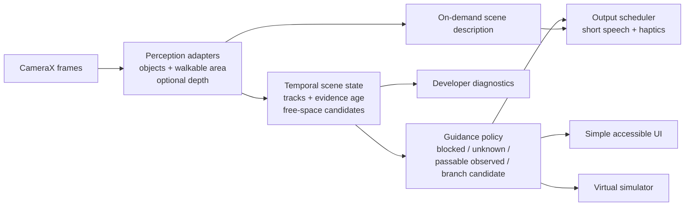

# TriGuide root architecture redesign

**Status:** Architecture direction selected. R0, distinct-frame voting, and the 0.9.12 box-extent correction are desktop-tested; Cursor completed the latest source review. The 0.9.12 candidate has not been installed or verified on the Redmi while ADB is disconnected. Historical verification language below describes the original R0 snapshot; use `docs/PROGRESS.md` for current results.
**Scope:** Phone-only visual assistance on the current Android app. No hardware or paid cloud service in this phase.

## What the video and code show

In the supplied phone recording, Live Vision displays detector/runtime diagnostics as the main screen. It reports about 4 inference FPS and a 157 ms average, then chooses `Slight left` because the detector placed a couch box on the right (confidence 0.64, about 23% of the image). The video shows no floor mask, depth measurement, tracked scene, or walkable-area result. It therefore demonstrates a box-based direction heuristic, not an understanding of the room or a junction.

The code confirms the same boundary:

- `SceneObservations.fromCamera` reduces each detector box to a label, image position, confidence, and area. It attaches no metric depth or walkable region.
- Before R0, `PathRiskAnalyzer.analyze(emptyList())` returned `CLEAR_OBSERVED` and `NavigationDecisionEngine` turned it into `STRAIGHT`. R0 maps empty, ignored-only, and off-corridor-only detector results to `UNKNOWN` and a stopped virtual robot. It also removes camera-box-only side-steering: a detected side obstacle now produces `HOLD`, because an empty box area on the other side is not positive evidence of a walkable gap. This source change has not yet been verified by a build, tests, or phone run.
- Camera observations are assembled from Compose code and fed to guidance on the 50 ms UI coroutine. The UI also exposes implementation diagnostics to the person using the camera.
- Floor segmentation is `NOT_STARTED`. The current scene model has no object tracks, connected free-space map, or junction representation.

The root defect is the contract between perception and guidance: “no detected object” is allowed to stand in for “observed free path.” A new object detector alone will not repair that contract.

## Target structure

Keep the existing Android project and `:sim-core` simulator. Start with clear package boundaries inside the app; create more Gradle modules only after the boundaries prove stable.

The important contracts are:

- **Perception output:** timestamped frame geometry and model evidence with explicit source and confidence. A missing model, stale frame, empty detection list, or invalid mask remains distinguishable.
- **Scene state:** combines successive frames, keeps object tracks and evidence age, and may contain a walkable-area mask. Detector boxes do not imply a free path.
- **Guidance:** emits a typed suggestion or uncertainty event. For camera input, `CLEAR_OBSERVED` is reserved for positive walkable-area evidence from a validated method; absence of detections maps to `UNKNOWN`, and obstacle boxes alone cannot authorize a side turn. The authored synthetic-world path remains separate and explicitly labeled.
- **Junctions:** report a “possible branch” only when separate walkable regions persist across frames with adequate image evidence. A label or a box on one side is not a junction. If the phone cannot determine whether left or right continues, say it is uncertain.
- **Output:** separate urgent obstacle cues, rare uncertainty cues, and user-requested scene descriptions. A description model must never drive steering. Keep diagnostics in a developer view.
- **Simulation:** consume guidance events through its own adapter. Simulator steering is not presented as verified pedestrian safety guidance.

## Small migration sequence

1. **Correct the evidence contract.** Implemented in source: object-detection-only results cannot produce `CLEAR_OBSERVED`, `STRAIGHT`, or a side-steering command; empty, ignored-only, and off-corridor-only detections are `UNKNOWN`, while detected corridor obstacles yield `HOLD`. Build, tests, and phone verification remain pending.
2. **Separate the layers.** Move camera-result adaptation and scene-state updates out of Compose. Keep `:app` and `:sim-core` for now; add stable interfaces for perception, scene state, guidance, and output.
3. **Measure the missing perception.** Compare a small walkable-area segmentation model plus the current detector on the actual Redmi. Record FPS, latency, heat/battery, missed obstacles, and false positives on labeled clips before selecting or combining models. Consider depth only as an optional device capability, never a required baseline.
4. **Add branch reasoning and calm narration.** Detect branches from the walkable-area structure over time; speak at meaningful transitions or when asked. Keep object naming and scene description separate from path choice.

This ordering avoids a from-scratch rewrite: the current camera, MediaPipe adapter, voice engine, and simulator can remain while their contracts change. A model swap is a later measured decision, not the first repair.

## Open-source choices and model/device research — 2026-10-18

There is no verified drop-in open-source Android app that solves TriGuide's exact phone-only indoor free-space and junction problem on this Redmi. GitHub popularity is not a quality or safety measure; repository stars were checked on 2026-10-18 and are only a rough activity signal. These two codebases are complementary *reference implementations*, not the two most popular projects, and “combine” means adopt compatible design ideas rather than copy either complete app.

| Project | Use in TriGuide | License and limitation |
| --- | --- | --- |
| [Sailens Android](https://github.com/wnbotoo/sailens-android) | Best architectural reference found for model-neutral perception contracts, walkable-area masks, detector/segmenter separation, and explicit model-output validation. | Apache-2.0 code; no model weights. Its README calls it pre-release, says target devices are Snapdragon 8 Gen 1+, and GitHub showed 0 stars when checked. Do not transplant its runtime or assume its target performance fits this Redmi. |
| [SightBuddy](https://github.com/DrophouseLtd/SightBuddy) | Best complementary interaction reference found for TalkBack-first controls, on-demand scene tasks, speech priorities, and camera processing flow. | MIT. GitHub showed 0 stars when checked. It is an accessibility vision tool, not a free-space or junction planner; do not introduce a cloud/API-key path from its optional features. |

GuideLens is the closest end-to-end navigation example found and is useful for studying segmentation and local path planning, but its repository is GPL-3.0 and showed one GitHub star when reviewed on 2026-10-18. Do not copy its source into TriGuide without a deliberate licensing decision. OpenBot is far more popular and MIT-licensed, but its main value is a future phone-to-robot boundary, not current phone-only navigation. None of those projects has validated TriGuide's corridor decisions on this phone.

### Model findings and practical recommendation

- Google's current ARCore supported-device list includes **Redmi Note 12 Pro — Supports Depth API**. This makes ARCore depth worth a runtime capability check on the actual phone, not a reason to require depth or assume every regional hardware variant is identical.
- ARCore depth is estimated primarily from camera motion and can combine supported hardware sensors. Google says it is most accurate around 0.5–5 m and improves when the phone moves; textureless surfaces can be imprecise. It is geometry evidence, not a walkable-floor label, so it cannot alone establish a safe route. References: [supported devices](https://developers.google.com/ar/devices), [Depth API](https://developers.google.com/ar/develop/depth), and [Raw Depth API](https://developers.google.com/ar/develop/java/depth/raw-depth).
- Integration is not a drop-in addition to the current CameraX pipeline: ARCore's SharedCamera requires camera-session changes and its documented shared-camera mode cannot use the depth sensor. The current domain policy also rejects `metricDepthAvailable` on `CAMERA_2D` as contradictory. Prototype depth behind a separate optional adapter only after checking the exact device/session path; keep CameraX fallback and do not set that flag until its evidence contract is redesigned. Reference: [ARCore SharedCamera](https://developers.google.com/ar/reference/java/com/google/ar/core/SharedCamera).
- MediaPipe ImageSegmenter can return category/confidence masks from a TFLite model with required metadata and a model-supplied label list. The current bundled detector is not such a walkable-area model. Any candidate must provide suitable indoor walkable-area classes and be evaluated for false walkable regions, not selected from a generic ADE/Cityscapes label alone. Reference: [ImageSegmenter API](https://ai.google.dev/edge/api/mediapipe/python/mp/tasks/vision/ImageSegmenter).
- SegFormer is a popular segmentation architecture, but NVIDIA's [official repository](https://github.com/NVlabs/SegFormer) restricts its work to non-commercial research/evaluation. Do not bundle that implementation/checkpoint without resolving the license for the project's intended distribution. Popularity is not a licensing shortcut.
- Other recently surfaced options were screened out as direct imports: [Atlas Sight](https://github.com/Digitalbrainstem/atlas-sight) is mainly a Python package, and its README says navigation distance is estimated from box size—the same evidence shortcut TriGuide must remove. [VisionAId](https://github.com/floreaGabriel/VisionAId) is a recent Kotlin/ONNX reference, but its README limits the work to academic/research use, describes optional Gemini dependencies, and does not establish free-space/junction safety on this Redmi. Treat their feature claims as project claims, not independently verified results.
- **Next practical prototype:** first benchmark a legally usable lightweight walkable-area mask beside the existing detector on labeled indoor phone clips; add timestamped temporal scene state and retain `UNKNOWN` on absent/stale/low-confidence masks. Evaluate ARCore depth as a separate optional experiment, not as the first integration. No replacement model is selected or bundled yet.

### Simulator comparison and decision

The app's `:sim-core` is a tiny on-phone 2D constant-curvature model used to demonstrate virtual steering. It is a reasonable fit for that purpose, but it is not a complete robot simulator: there are no collisions, wheel slip, inertia, obstacles as geometry, camera, or sensor physics. Its previous explicit-Euler position step was unnecessarily inaccurate for a fixed steering command; Codex replaced it with exact circular-arc integration and updated the expected assertions. Those assertions have not been run.

[Webots](https://github.com/cyberbotics/webots) is the best open-source high-fidelity candidate found for desktop robot/world/sensor experiments (Apache-2.0 core; about 4.7k GitHub stars on 2026-10-18). It is a standalone desktop simulator, not a Kotlin/Android library or drop-in replacement. Its sample robot and world assets can have separate licenses, so each would need review before reuse. The right boundary is to retain `:sim-core` for an installable phone demo and, if physics/sensors later become necessary, create a separate Webots world/controller as an offline development and simulation-parity harness. Do not copy the Webots engine into the APK.

[ROS-Mobile](https://github.com/ROS-Mobile/ROS-Mobile-Android) was also checked: it is an Android ROS visualization/control client, not a self-contained physics simulator, so it cannot replace `:sim-core`. OpenBot is a useful future phone-to-robot reference but likewise does not meet today's standalone on-phone simulation role.

## Ownership and follow-up

- **Codex owns:** video/code diagnosis, external project and license comparison, target architecture, model-selection criteria, R0 and exact-arc simulator corrections, and review of Cursor’s evidence against this document.
- **Cursor owns:** review the R0 camera-evidence and exact-arc simulator changes through the latest `CURSOR_TASK`, preserve unrelated user changes, and report any defect or missing case in `docs/BRIDGE_TO_GPT.md`.
- **First migration slice:** R0 is implemented locally. Do not add a segmentation model or junction claims in its review.

